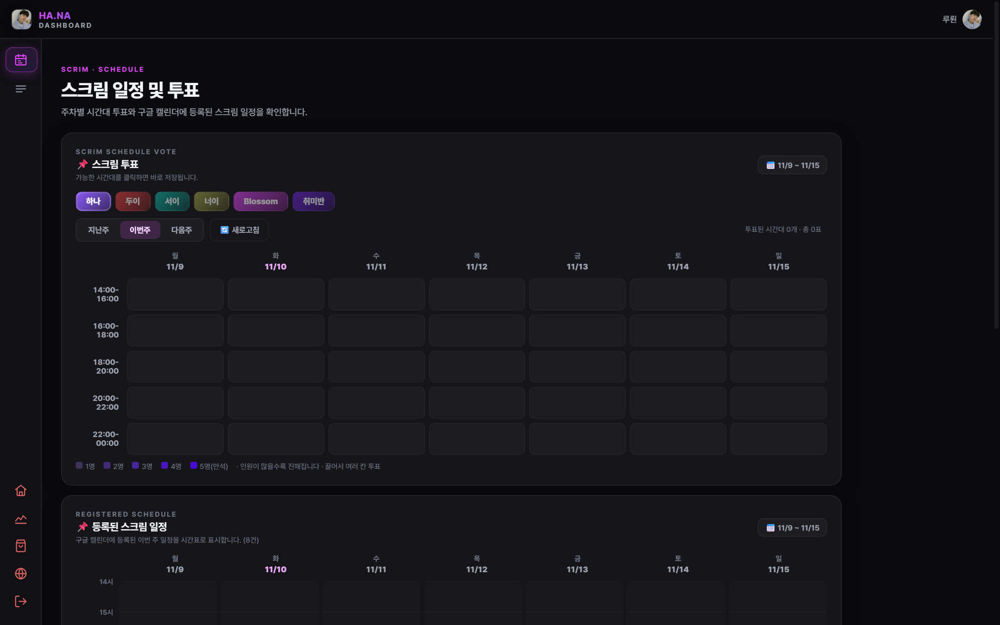
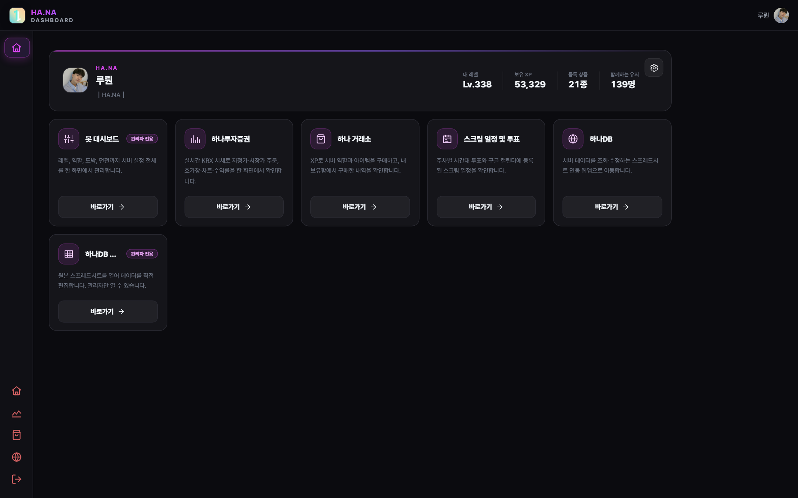
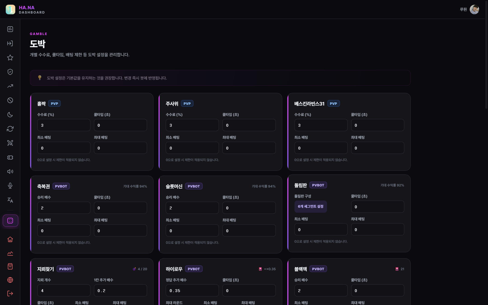
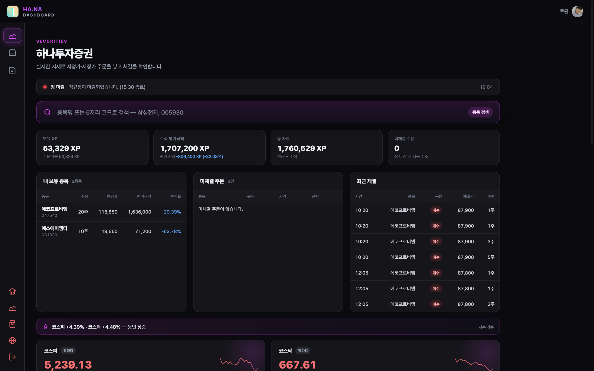
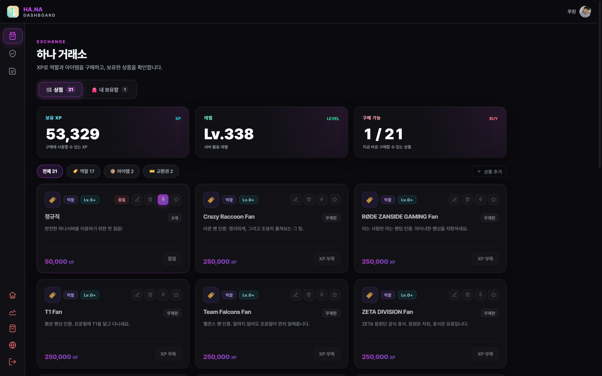

# HA.NA — 커뮤니티 운영 자동화 (디스코드 봇 + 웹 대시보드)

오버워치 커뮤니티 서버와 산하 팀을 운영하며, 매주 반복되던 운영 업무를 자동화한 프로젝트입니다.
기획 · 설계 · 개발 · 배포 · 운영을 1인이 수행했습니다.

- 실사용: 커뮤니티 139명 / 거래소 상품 21종
- 규모: Python 102개 파일 · 44,139줄 · 웹 관리 화면 37개
- 운영: 안드로이드 기기 1대에서 봇 + 웹 동시 상주, 20초 주기 자동 복구

> **이 저장소는 포트폴리오용 발췌본입니다.**
> 전체 코드는 4만 줄이 넘어 읽기 어렵기 때문에, 핵심 모듈 4개와 운영 스크립트 1개(약 1,465줄)만 담았습니다.
> 토큰 · OAuth 키 · 사용자 DB는 포함하지 않았습니다(아래 [보안](#보안) 참조).

## 스크린샷

| 스크림 일정·투표 | 운영 관리 홈 |
|---|---|
|  |  |

| 미니게임 설정 | 실시간 시세 기반 모의 주문 |
|---|---|
|  |  |

거래소(상품 21종): 

## 무엇을 자동화했나

| 영역 | 기존 | 자동화 후 |
|---|---|---|
| 스크림 일정 | 채팅 수십 개를 손으로 대조 | 주차별 투표 → 확정 → 게시판·캘린더 자동 반영 |
| 운영 설정 | 코드·명령어를 아는 사람만 변경 | 웹 화면에서 운영진이 직접 변경 (37개 화면) |
| 회원 관리 | 수기 공지·등급 부여 | 레벨·역할·부스트·휴면·시즌 자동 처리 |
| 경제 | 없음 | XP 거래소·미니게임·던전·낚시·요리 |
| 데이터 | 감으로 판단 | 주문·체결·변동 로그 기록, 통계 화면 |

## 구조

```
discord-bot/
├── main.py            # 봇 진입점 · 확장 로딩
├── core/              # 도메인 로직 (설정 스키마 · 거래 · 캘린더)
├── systems/           # 기능 모듈 37개 (스크림 · 경제 · 레벨 · 티켓 · TTS · 번역)
│   └── gamble/        # 미니게임 (봇 대전 · PVP)
├── web/               # FastAPI 대시보드 (라우트 · 세션 · OAuth)
│   └── templates/     # 화면 37개
└── data/              # 길드별 설정 · 사용자 데이터
```

## 포함된 파일

| 파일 | 설명 |
|---|---|
| `src/scrim_booking.py` | 스크림 일정 보드 · 상대 정보 기록 · 취소/추가 · 용병 모집 연동 |
| `src/scrim_board.py` | 채널 게시판 렌더링과 갱신 |
| `src/gamble_settings.py` | 미니게임 설정 스키마(확률 · 수수료 · 쿨타임), 웹과 봇이 같은 값을 읽음 |
| `src/gamble_common.py` | 미니게임 공통 처리(베팅 검증 · 정산) |
| `src/keepalive.sh` | 20초 주기 워치독 — 죽은 프로세스만 재기동, PID 재사용 방어 |
| `docs/architecture.md` | 운영 구조와 설계 결정 |
| `docs/verification.md` | 어떻게 검증했는가(로그 · 재기동 시험) |

## 설계에서 지킨 것

1. **가장 반복되는 하나부터.** 일정 조율 하나에 작은 기능을 붙여 일주일 써보고, 피드백을 받아 범위를 넓혔습니다.
2. **운영자가 코드를 몰라도 바꿀 수 있어야 유지된다.** 모든 기능에 설정 화면을 붙였습니다.
3. **AI가 준 코드는 검증 설계 없이는 자산이 아니다.** 실패 로그를 남기고, 재부팅 후 자동 복구까지 시험했습니다.
4. **위험한 변경은 한 경로로.** 지급·차감·주문은 단일 함수로 모으고 모든 변동을 로그로 남겼습니다.

## 보안

- 실제 봇 토큰 · OAuth client secret · 거래 API 키 · 세션 시크릿은 **저장소에 없습니다.**
- 사용자 데이터베이스(`user_data.db`), 시세 캐시(`market.db`), `credentials/` 디렉터리는 **제외**했습니다.
- 운영 환경에서는 자격 증명을 파일이 아닌 환경 변수/시크릿 저장소로 주입합니다.

## 문의

요청 시 코드 리뷰 세션 또는 추가 화면 캡처로 확인해 드릴 수 있습니다.
