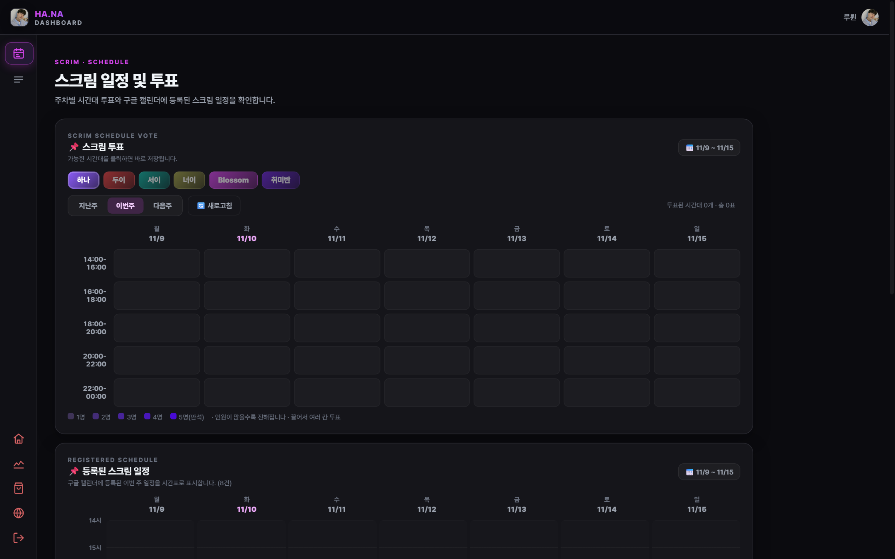
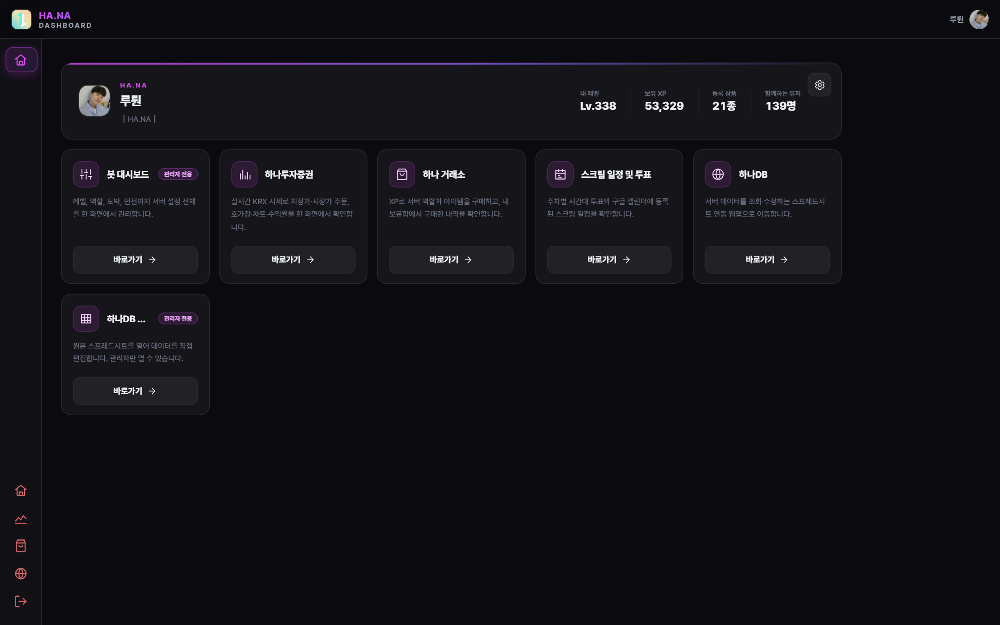
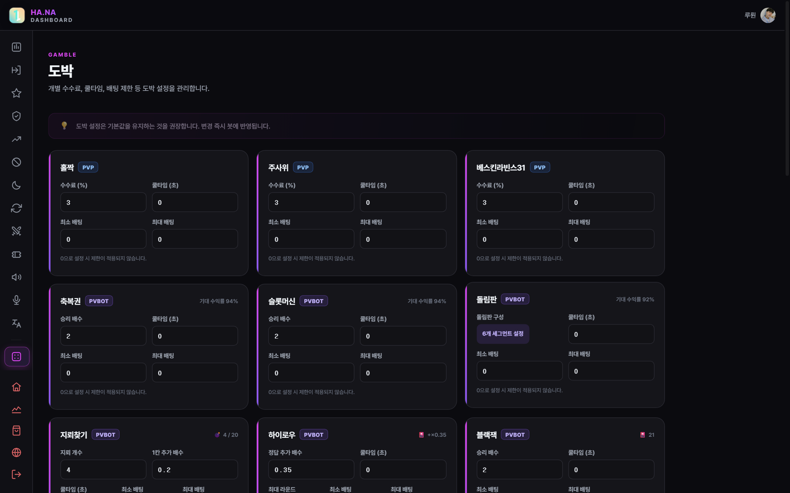
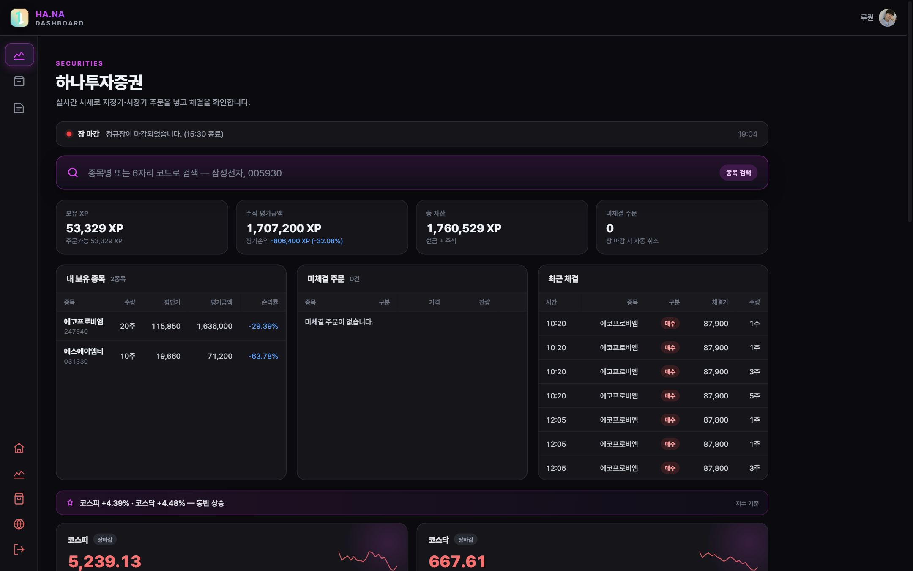
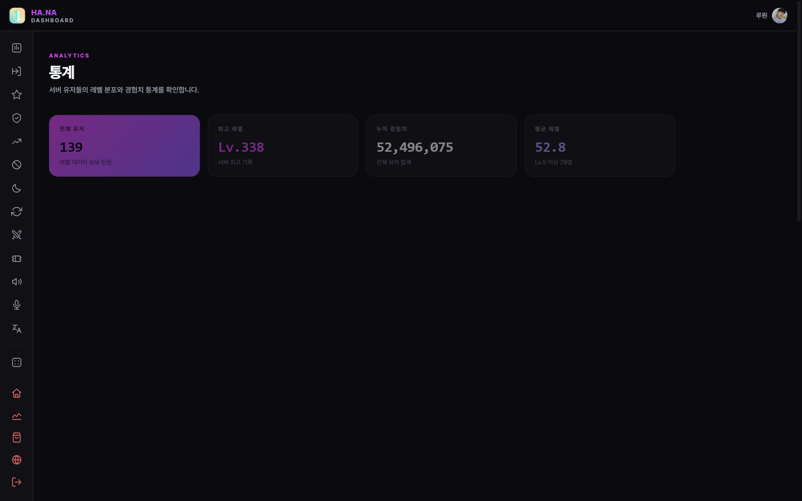
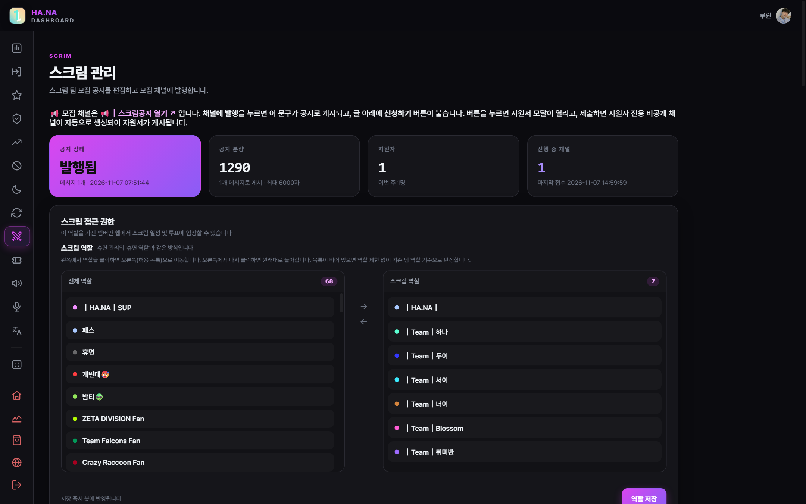
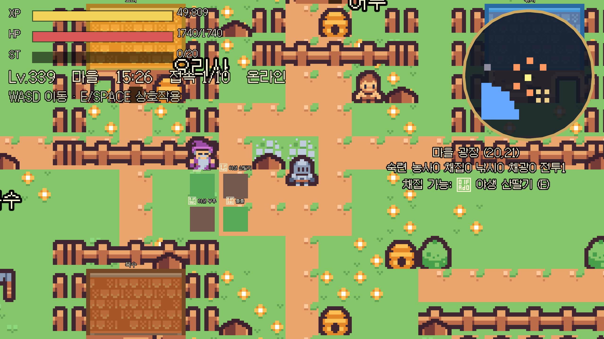
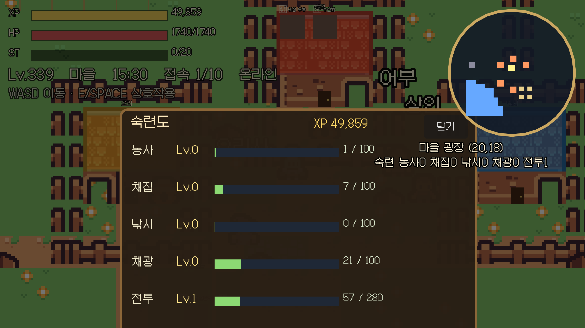
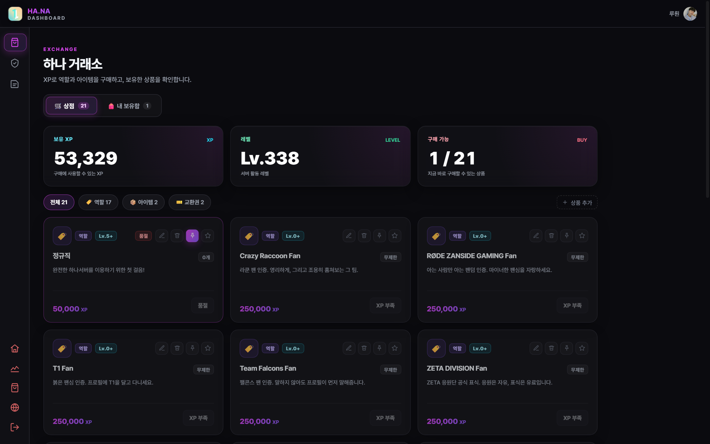

# HA.NA — 커뮤니티 운영 자동화 (디스코드 봇 + 웹 대시보드 + 게임 클라이언트)

오버워치 커뮤니티 서버와 산하 팀을 운영하며, 매주 반복되던 운영 업무를 자동화한 프로젝트입니다.
기획 · 설계 · 개발 · 배포 · 운영을 1인이 수행했습니다.

- 실사용: 누적 220명 중 활동 사용자 193명 / 모의 주식 40종 · 체결 206건
- 규모: Python 132개 파일 · 57,860줄 / 웹 화면 34개(13,763줄) / Godot 게임 클라이언트 4,515줄
- 검증: 순수 로직 단위 테스트 60개 (숙련도 17 + 채집 13 + 농사 30)
- 운영: 안드로이드 기기 1대에서 봇 + 웹 동시 상주, 20초 주기 자동 복구

> **AI는 코딩을 도와줄 수 있지만, 검수와 전체 구조·아이디어 설계는 여전히 사람의 영역입니다.**
> 가격·확률·보상을 서버가 내려주고 클라이언트는 계산하지 않게 한 것도, AI가 만든 코드를 로그로 확인한 뒤에만
> 배포한 것도 같은 판단이었습니다. AI는 도구이므로, AI 환경이 좋아질수록 *그것을 무엇에 어떻게 쓸지 정하는
> 아이디어*가 핵심 가치가 된다고 봅니다.

> **이 저장소는 포트폴리오용 발췌본입니다.**
> 전체 코드는 5만 줄이 넘어 읽기 어렵기 때문에, 핵심 모듈과 그 단위 테스트만 담았습니다.
> 토큰 · OAuth 키 · 사용자 DB는 포함하지 않았습니다(아래 [보안](#보안) 참조).

## 스크린샷

| 스크림 일정·투표 | 운영 관리 홈 |
|---|---|
|  |  |

| 미니게임 설정 | 실시간 시세 기반 모의 주문 |
|---|---|
|  |  |

| 누적 통계 | 스크림 운영 관리 |
|---|---|
|  |  |

| Godot 게임 — 마을 | 숙련도 (서버가 내려준 값) |
|---|---|
|  |  |

거래소: 

## 무엇을 자동화했나

| 영역 | 기존 | 자동화 후 |
|---|---|---|
| 스크림 일정 | 채팅 수십 개를 손으로 대조 | 주차별 투표 → 확정 → 게시판·캘린더 자동 반영 |
| 운영 설정 | 코드·명령어를 아는 사람만 변경 | 웹 화면에서 운영진이 직접 변경 (34개 화면) |
| 회원 관리 | 수기 공지·등급 부여 | 레벨·역할·부스트·휴면·시즌 자동 처리 |
| 경제 | 없음 | XP 거래소 · 미니게임 · 숙련도 · 농사 · 낚시 · 요리 |
| 데이터 | 감으로 판단 | 주문·체결·변동 로그 기록, 통계 화면 |

## 구조

```
discord-bot/
├── main.py            # 봇 진입점 · 확장 로딩
├── core/              # 도메인 로직 (설정 스키마 · 거래 · 캘린더)
├── systems/           # 기능 모듈 47개 (스크림 · 경제 · 숙련도 · 티켓 · TTS)
│   ├── skills.py      # 5종 숙련도 — DB/웹 비의존 순수 로직
│   ├── gathering.py   # 채집·채광 노드 — DB/웹 비의존 순수 로직
│   └── gamble/        # 미니게임 (봇 대전 · PVP)
├── web/               # FastAPI 대시보드 (라우트 · 세션 · OAuth)
│   └── templates/     # 화면 34개
├── godot/             # 모바일 게임 클라이언트 (GDScript 4,300줄)
└── data/              # 길드별 설정 · 사용자 데이터
```

## 포함된 파일

| 파일 | 설명 |
|---|---|
| `src/scrim_booking.py` | 스크림 일정 보드 · 상대 정보 기록 · 취소/추가 · 용병 모집 연동 |
| `src/scrim_board.py` | 채널 게시판 렌더링과 갱신 |
| `src/gamble_settings.py` | 미니게임 설정 스키마(확률 · 수수료 · 쿨타임), 웹과 봇이 같은 값을 읽음 |
| `src/gamble_common.py` | 미니게임 공통 처리(베팅 검증 · 정산) |
| `src/skills.py` | 5종 숙련도(농사·채집·낚시·채광·전투) 레벨표·직업·효율 계산 순수 로직 |
| `src/gathering.py` | 채집·채광 노드 정의, 레벨 게이트, 품질 판정, 리스폰 |
| `src/test_skills.py` | 숙련도 단위 테스트 17개 |
| `src/test_gathering.py` | 채집·채광 단위 테스트 13개 |
| `src/keepalive.sh` | 20초 주기 워치독 — 죽은 프로세스만 재기동, PID 재사용 방어 |
| `docs/architecture.md` | 운영 구조와 설계 결정 |
| `docs/verification.md` | 어떻게 검증했는가(로그 · 재기동 시험 · 테스트) |

### 테스트 직접 실행

```bash
cd src
python test_skills.py      # === 17개 테스트 전부 통과 ===
python test_gathering.py   # === 13개 테스트 전부 통과 ===
```

의존성이 없는 순수 로직이라 표준 라이브러리만으로 실행됩니다.

## 설계에서 지킨 것

1. **가장 반복되는 하나부터.** 일정 조율 하나에 작은 기능을 붙여 일주일 써보고, 피드백을 받아 범위를 넓혔습니다.
2. **운영자가 코드를 몰라도 바꿀 수 있어야 유지된다.** 모든 기능에 설정 화면을 붙였습니다.
3. **AI가 준 코드는 검증 설계 없이는 자산이 아니다.** 실패 로그를 남기고, 재부팅 후 자동 복구까지 시험했습니다.
4. **규칙은 규칙표로 고정하고 로직에서 분리한다.** 숙련도·채집 같은 시스템은 원작 규칙표를 데이터로 두고
   DB·화면에 의존하지 않는 순수 함수로 분리해, 화면 없이도 단위 테스트로 검증됩니다.
5. **위험한 변경은 한 경로로.** 지급·차감·주문은 단일 함수로 모으고 모든 변동을 로그로 남겼습니다.


## 게임 클라이언트 ↔ 서버 XP 원장

디스코드 채팅 · 웹 대시보드 · Godot 게임이 **하나의 XP 원장**을 공유합니다.
도박으로 잃은 XP가 게임에서 영토를 사지 못하게 하고, 게임에서 번 XP가 휴면 판정의 근거가 됩니다.

### 이 프로젝트에서 가장 오래 붙잡은 문제

Godot 웹(WASM) 빌드에서 `HTTPRequest`로 인증 API를 호출하면 **401만** 돌아옵니다.
브라우저 세션 쿠키를 노드가 자동으로 붙여주지 않기 때문입니다. 네이티브에서는 같은 코드가 정상 동작합니다.

해결: 웹 빌드에서는 `JavaScriptBridge.eval`로 **브라우저 자신의 `fetch`** 를 호출하고
(`credentials: 'include'`), 결과를 `window.<key>`에 담아 폴링으로 회수합니다.
네이티브는 기존 `HTTPRequest` 경로를 그대로 씁니다 — **한 코드, 두 환경**.

```gdscript
# src/game/Main.gd — _js_fetch()
var js := "window.%s=null;" \
          "fetch('%s',%s).then(async r=>{" \
          "  const t=await r.text();" \
          "  window.%s={code:r.status,body:t}" \
          "})" % [key, path, init, key]
JavaScriptBridge.eval(js)
pending.append({"key": key, "cb": cb})
```

### 클라이언트는 계산하지 않는다

가격·확률·보상은 전부 서버 `/api/game/bootstrap`이 내려줍니다. 클라이언트는 그리기와 입력 전달만 합니다.
액션 응답을 낙관적으로 쓰지 않고 **항상 재부트스트랩**합니다.

```gdscript
func _on_act_data(code: int, data: Dictionary):
	_toast(_act_message(panel_mode, data))
	_fetch_boot()          # ← 서버가 최종 판정자
```

### 모든 XP 변경이 통과하는 단일 경로

`src/game/ledger.py` — 채팅 XP 지급과 게임 보상이 서로의 변경을 덮어쓰지 않도록
확인과 차감을 같은 트랜잭션(`db.change_user`) 안에서 처리합니다.

### 규모

| 항목 | 값 |
|---|---|
| 게임 클라이언트 (`Main.gd`) | 4,515줄 |
| 게임 전용 API (`/api/game/*`) | 7개 |
| 미니게임 API (`/api/minigame/*`) | 29개 |
| 던전 | 10층 · 21×15 그리드 · 턴제 전투 |
| 숙련도 | 5종 × 10레벨 + 직업 2택 |
| 실행 환경 | 웹(WASM) / 네이티브 — 동일 코드 |

관련 파일: [`src/game/Main.gd`](src/game/Main.gd) · [`src/game/ledger.py`](src/game/ledger.py) · [`docs/game_contract.md`](docs/game_contract.md)

### 빌드 산출물은 저장소에 없습니다

웹 실행에 필요한 `index.wasm`(38MB) · `index.pck`(5.3MB) 등은 **재생성 가능한 산출물**이라 커밋하지 않았습니다.
합계 57MB이고, 대용량 바이너리는 저장소를 무겁게 만들어 검토에도 도움이 되지 않습니다.

| 항목 | 크기 | 저장소 포함 |
|---|---|---|
| `index.wasm` | 38MB | ✗ |
| `index.pck` | 5.3MB | ✗ |
| `index.js` | 274KB | ✗ |
| `src/game/Main.gd` (소스) | 157KB | ✓ |
| `src/game/ledger.py` | 1.2KB | ✓ |

대신 **빌드 없이 코드를 읽고 검증**할 수 있게 했습니다.
클라이언트 전체 소스(`Main.gd` 4,515줄), 서버 계약(`docs/game_contract.md`), 재화 원장(`ledger.py`),
그리고 **설치 없이 실행되는 테스트 60개**입니다.

```bash
cd src && python test_skills.py     # 17개 통과
cd src && python test_gathering.py  # 13개 통과
```

> 라이브 게임은 로그인 세션이 필요해 외부에서 바로 열리지 않습니다.
> 화면은 [`images/09_game_town.png`](images/09_game_town.png) · [`images/10_game_skills.png`](images/10_game_skills.png) 에 실제 캡처로 남겼습니다.

## 보안

- 실제 봇 토큰 · OAuth client secret · 거래 API 키 · 세션 시크릿은 **저장소에 없습니다.**
- 사용자 데이터베이스(`user_data.db`), 시세 캐시(`market.db`), `credentials/` 디렉터리는 **제외**했습니다.
- 운영 환경에서는 자격 증명을 파일이 아닌 환경 변수/시크릿 저장소로 주입합니다.

## 수치 기준

위 규모·실사용 수치는 2026-11-15 로컬 소스 트리와 DB를 직접 계측한 값입니다.

```bash
# 파일 수 · 줄 수 (캐시·백업 제외)
find . -name "*.py" -not -path "*/__pycache__/*" -not -path "*/bak/*" -not -path "*/tmp/*" -print0 | xargs -0 cat | wc -l
# 사용자 · 주식 · 체결
sqlite3 user_data.db "select count(*) from users"
sqlite3 market.db     "select count(*) from stocks; select count(*) from trades;"
```

## 관련 저장소

| 저장소 | 내용 |
|---|---|
| `community-ops-showcase` (이 저장소) | 커뮤니티 운영 자동화 — 봇 + 웹 대시보드 + 게임 클라이언트 |
| `blog-autopilot` | 수집 → AI 초안 → 사람 검토 파이프라인. 6종 모델 폴백 + 회로 차단 설계 |

## 문의

요청 시 코드 리뷰 세션 또는 추가 화면 캡처로 확인해 드릴 수 있습니다.
